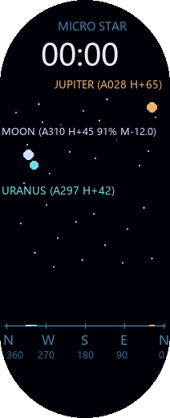

# Openband

在 Windows 上复现小米手环 10 NFC 的通信流程，把自制星图装成手环的默认表盘。验证基线为 **M2456B1 / `miwear.watch.o66nfc` / 固件 3.1.16**。



## 从 APK 到自定义表盘

1. **分析官方 App 的通信协议。** 用 REA 和 JADX 反编译小米运动健康 3.59.2 的 Android 安装包，追踪账号绑定、蓝牙传输和身份认证，以及命令编码和回复解析。[分析步骤与原始样本](docs/reverse-engineering.md)
2. **建立电脑与手环的正式连接。** 先通过 BLE 与小米服务器和手环完成账号绑定，取得绑定阶段的 `device_key`。再从已绑定设备记录取得 `encrypt_key`，经 Windows 经典蓝牙 SPP 建立连接，并通过 WearAuthV2 完成双向认证。[通信流程](docs/protocol.md)
3. **从原厂表盘中解包出 Lua 脚本。** 从匹配的 OTA 固件包提取表盘分区，解包其中的 `resource.bin`。参考原厂 Lua 如何使用 `lvgl` 绘图、订阅 `dataman` 的数据更新，以及在屏幕亮起时检查是否需要刷新。[表盘提取步骤](docs/reverse-engineering.md#从-ota-提取原厂表盘)
4. **用 Lua 实现离线星图。** 根据 Paul Schlyter 的近似轨道公式计算太阳、月亮和行星的位置，用 Astronomy Engine 做抽样对照。手环根据自身时间和预设的观测地点经纬度计算方位角与高度角，约每 30 秒更新一次星图。[计算源码](watchface/sky.lua) · [界面源码](watchface/face.lua) · [Astronomy Engine](vendor/astronomy-engine/astronomy.js)
5. **打包、安装并切换为默认表盘。** 把 Lua、表盘定义和预览图打包成 `o66` 格式的 `.bin`，通过已认证的 SPP 连接用 MASS 分块发送。手环返回安装结果后，客户端请求切换并读回当前表盘。星图由手环本地运行。[安装源码](client/watchfaces.py) · [Micro Star 2 安装包](watchface/releases/micro-star-v2.bin)

## 在 Windows 上运行

需要支持经典蓝牙和 BLE 的 Windows 电脑、Python 3.11 或更新版、Node.js 和 Chrome。重建表盘还需要 JDK、Git 和项目的 Node 依赖。

```powershell
python -m pip install -r client/requirements.txt
npm ci

$bandAddress = Read-Host '手环蓝牙地址'
node client/login_helper_v2.cjs (Join-Path (Get-Location) '.state')
python client/client.py probe --address $bandAddress
python client/client.py bind --address $bandAddress --test-notification
```

在浏览器中亲自登录小米账号，按提示在手环上确认绑定和 Windows 配对。需要重新开放配对时，在手环的「设置 → 系统操作」使用「连接新手机」。首次绑定依赖小米服务。后续可以用 `python client/client.py notify --address $bandAddress` 复用本机 DPAPI 保护的连接资料。

```powershell
python client/watchfaces.py --address $bandAddress list
python client/watchfaces.py --address $bandAddress install watchface/releases/micro-star-v2.bin
python client/watchfaces.py --address $bandAddress list
```

列表中的 `current: true` 表示当前表盘。已安装同 ID 时可以运行 `python client/watchfaces.py --address $bandAddress select 826104732`。设备需要有可用表盘槽位。安装入口只处理新增。仓库中的包由实机验证过的星图逻辑重新构建，发布构建已做 Lua 字节往返与模拟验证。

## 自定义和重建

示例使用 [watchface/observer.example.json](watchface/observer.example.json) 中的零度经纬度。修改 [watchface/build.py](watchface/build.py) 中的 `ID` 可为自定义版本分配新的数字 ID，最多 9 位。保持手环时间和时区准确。

```powershell
New-Item -ItemType Directory -Force build | Out-Null
git clone https://github.com/zhy8388608/Mi8WfBinTool.git build/Mi8WfBinTool
git -C build/Mi8WfBinTool checkout --detach 5e4195ce91b9d8810a7a2233c96b4cba44184adc
git -C build/Mi8WfBinTool apply ../../tools/o66-unpack.patch
./tools/build-watchface.ps1
```

新包位于 `build/watchface/micro-star-v2.bin`。构建脚本会重新解包并核对生成的 Lua 字节。

要使用自己的观测地点，可以把示例复制到本机的 `.state/observer.json`，编辑经纬度后用 `./tools/build-watchface.ps1 -ObserverFile .state/observer.json` 构建。自定义包和预览保存在 `build/watchface-local/`，这两个本机目录都由 Git 忽略。坐标会写入自定义安装包，请只分享用示例坐标构建的包。

测试可用以下入口。

```powershell
python -m unittest discover -s client -p 'test_*.py'
node --test client/test_login_flow.cjs
python watchface/tests/compare.py
python watchface/tests/collision.py
```

[第三方项目和授权说明](docs/credits.md)
