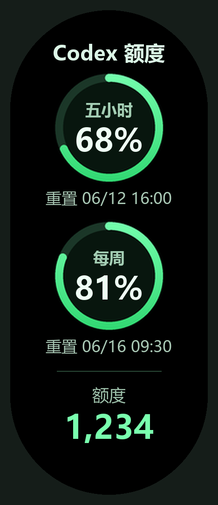

# Codex 手环额度显示



图中的额度为示例数字。

## 数据如何到达手环

1. [Windows 连接器](../client/codex_quota.py)启动已登录的本机 Codex app-server，走标准输入和输出，依次执行 `initialize`、`initialized` 并按需读取 `account/rateLimits/read`。读取结果优先使用 `rateLimitsByLimitId.codex`，可用时回退到 `rateLimits`。
2. 连接器按实际窗口长度选择 300 分钟和 10,080 分钟两档，用 100 减去已用百分比，重置时间采用电脑的时区。余额显示整数部分，界面加入千位分隔符。缺字段时显示占位符。
3. 从已配对的 Windows 连接建立 SPP V2 会话，通过 WearAuthV2 双向认证，然后从手环应用清单读出 Codex 应用的包名和指纹。打开应用时设备发送 `20/6`。电脑核对身份，回复 `20/7`，主动用加密 `20/8` 推送额度。用户点屏幕后可以从手环通过 `20/9` 请求刷新。
4. [全屏界面](../apps/codex-quota/watch/src/pages/index/index.ux)将两个百分比分别映射到 0–100 的 [圆环图片](../apps/codex-quota/build_quota_assets.py)，把重置时间排在对应圆环下方。页面提供超时、断连状态。额度之外的对话内容和账号凭据不经过这个连接器。

## 构建和使用

先按 [README](../README.md#在-windows-上运行) 准备已有手环配对和本机连接资料。确保当前 Windows 用户可以运行 `codex`，并已在 Codex 登录要查看的账号。

```powershell
python -m pip install -r client/requirements.txt
python apps/codex-quota/build_quota_assets.py
Push-Location apps/codex-quota/watch
npm.cmd install
npm.cmd run build
Pop-Location

$bandAddress = Read-Host '手环蓝牙地址'
python client/quickapps.py --address $bandAddress install codex-quota
python client/codex_quota.py --address $bandAddress
```

在手环打开「Codex」即可自动读额度。连接器需要持续运行。安装更新或用其他工具独占 SPP 之前，先在连接器终端按 Ctrl+C。已有同名应用的升级方式见 [Quick App 说明](quickapps.md)。

同一链路和界面已在小米手环 10 NFC 上确认显示两档百分比、重置时间和整数余额。公开源码采用同一协议，示例图只由本地脚本用模拟数据生成。
